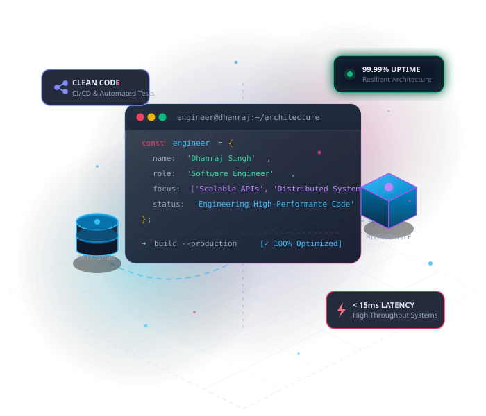

# Dhanraj Singh — Software Engineer Portfolio

A modern, high-performance, responsive developer portfolio built strictly with **pure HTML5 and CSS3** (zero JavaScript, zero framework dependencies, ultra-fast load time, 100% accessible).



---

## 🚀 Key Highlights & Architectural Features

- **Pure HTML5 & CSS3**: No JavaScript runtime required. Fast rendering, zero client-side overhead, smooth 60fps animations.
- **Modern Dark Tech Aesthetic**: Inspired by high-end developer platforms with deep dark slate backgrounds (`#080c16`), ambient radial glow meshes, and vivid neon cyan (`#38bdf8`) & indigo accents.
- **Custom Aesthetic Vector Visuals (SVG)**:
  - `hero-illustration.svg` — 3D isometric systems architecture with servers, floating code terminal, and uptime metrics.
  - `about-avatar.svg` — Stylized engineer avatar persona with HUD targeting reticles, orbital tech rings, and `<DS/>` monogram.
  - 4 project architecture SVGs illustrating distributed streaming pipelines, real-time observability telemetry, zero-trust API gateways, and algorithmic trees.
- **Pure CSS Interactive Controls**:
  - **Zero-JS Mobile Navigation Drawer**: Built using the CSS checkbox toggle pattern with an animated hamburger-to-X icon and backdrop tap-to-dismiss.
  - **Zero-JS Dynamic Project Filter**: Uses modern CSS `:has()` parent selectors and radio inputs to filter projects by category (*All*, *Distributed & Cloud*, *Observability*, *Core Algorithms*) with zero JavaScript.
- **Instant Resume Download**: Pre-bundled authentic PDF resume (`assets/Dhanraj_Singh_Resume.pdf`) ready for recruiters and engineering hiring managers.
- **Responsive Layout**: Designed mobile-first, looking sharp on 320px mobile screens, tablets, laptops, and 4K displays.

---

## 📁 Repository Structure

```text
Portfolio/
├── index.html                       # Semantic HTML5 document & content structure
├── css/
│   └── styles.css                   # Modular CSS design system & responsive rules
├── assets/
│   ├── Dhanraj_Singh_Resume.pdf     # Valid 1-page software engineer resume
│   ├── resume.pdf                   # Alias for resume download
│   ├── hero-illustration.svg        # 3D isometric system graphic
│   ├── about-avatar.svg             # Aesthetic avatar with orbital rings
│   ├── project-distributed.svg      # Event streaming pipeline graphic
│   ├── project-observability.svg    # Real-time metrics dashboard graphic
│   ├── project-gateway.svg          # API gateway & security graphic
│   └── project-algo.svg             # Algorithmic balance tree graphic
└── README.md                        # Documentation & deployment guide
```

---

## 💻 How to Run Locally

Because this portfolio uses pure HTML & CSS with zero external build tools, you can run it immediately without `npm install`:

### Option 1: Direct Browser Launch
Double-click `index.html` in your file explorer, or in your terminal:
```bash
open index.html
```

### Option 2: Local HTTP Server (Python)
```bash
python3 -m http.server 3000
```
Then visit `http://localhost:3000` in your browser.

---

## ✏️ Customization Quick-Guide

To customize details for your own profile:

1. **Personal Information & Bio**:
   - Open `index.html` and search for `Dhanraj Singh` or `dhanrajsingh.dev@gmail.com` to replace with your exact email, GitHub username, and LinkedIn profile URL.
2. **Resume**:
   - Replace `assets/Dhanraj_Singh_Resume.pdf` with your own latest PDF file whenever you want to update it.
3. **Projects**:
   - In `index.html` under `<section id="projects">`, update project titles, descriptions, metrics, and GitHub repo links to match your actual work.

---

## 🌐 Free 1-Click Deployment Options

### 1. GitHub Pages (Recommended — 100% Free)
1. Push this repository to GitHub:
   ```bash
   git add .
   git commit -m "feat: launch Dhanraj Singh software engineer portfolio"
   git branch -M main
   git remote add origin https://github.com/<your-username>/portfolio.git
   git push -u origin main
   ```
2. Go to your repository on GitHub → **Settings** → **Pages**.
3. Under **Branch**, select `main` and `/ (root)`, then click **Save**.
4. Your site will be live at `https://<your-username>.github.io/portfolio/` within 60 seconds!

### 2. Vercel
Run:
```bash
npx vercel
```
Follow the prompt, and Vercel will deploy it instantly to a free global CDN.

### 3. Netlify
Run:
```bash
npx netlify deploy --prod --dir=.
```

---

## 📄 License
MIT © 2026 Dhanraj Singh
